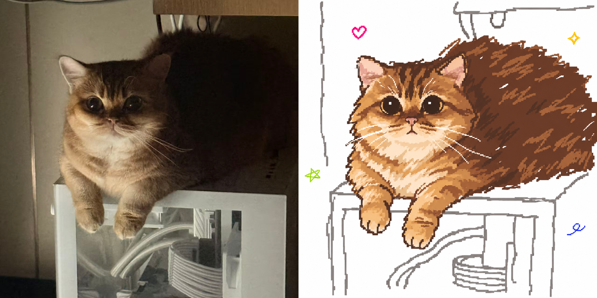
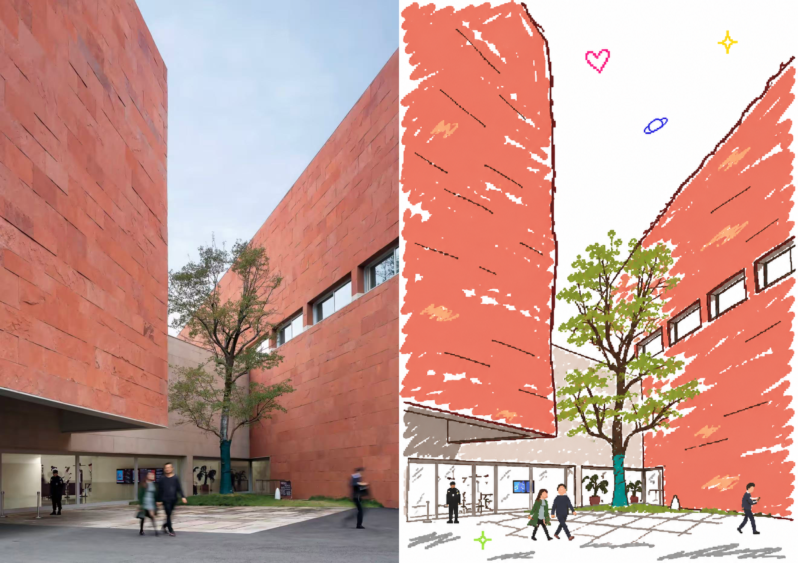

# Y2K Pixel Doodle

English | [简体中文](README.zh-CN.md)

Turn a photo into a white-background, hand-drawn pixel doodle inspired by early desktop painting programs. The skill preserves the subject's recognizable pose and expression while using uneven mouse-drawn lines, loose color fills, and tiny colorful marks.

It works with portraits, pets, objects, architecture, and landscapes. You can ask for a finished illustration or a reusable image-generation prompt.

## Examples

Each comparison is a single image: original on the left, generated illustration on the right.

### Pet



### Architecture



## What the skill does

- **Uses one pixel-pencil style throughout.** Facial features, outlines, scenery, and small decorations share a coarse pixel grid, line weight, and irregularity.
- **Keeps the expression readable.** Eye direction, eyelid shape, eyebrows, and mouth position guide the redraw. The subject's pose, key features, and spatial relationships remain recognizable.
- **Adds handmade imperfections.** Uneven outlines, a few missed pixels, loose strokes, and slightly misaligned color fills give the image its doodle quality.
- **Adapts the background.** For a person, pet, or object, a few bent structural lines suggest the setting while keeping attention on the subject. For a landscape, the important shapes and depth guide the drawing.
- **Adds tiny accents.** A few irregular colored hearts, stars, loops, or other marks sit in the white space by default.
- **Follows the source frame.** The skill aims to retain the input's composition, aspect ratio, and pixel dimensions. Exact generation and export options depend on the available tools.

Explicit instructions override these defaults. For example, you can request a plain white background without decorations or specify a different aspect ratio.

## Requirements and agent support

This skill uses the [Agent Skills format](https://agentskills.io/specification). One `SKILL.md` contains the shared visual rules; installation and available image tools vary by host.

- **Illustration mode:** the host must inspect the source image and have a generation/editing tool that accepts reference images.
- **Prompt mode:** with image understanding but no suitable generation tool, the assistant returns a tailored prompt and known image dimensions, and states that no image was generated.
- **Description-only mode:** without image understanding, the assistant can use your written description but cannot verify the photo's contents.
- The skill includes no image model, API account, or generation service. Installing it does not add those capabilities. Different models may render the same rules differently.

Installation instructions are provided for **Codex, WorkBuddy, Doubao Work, Qoder, and the open-source MiniMax Code CLI**. MiniMax Code desktop import details remain unverified. These are documented installation routes, not a claim that this revision has been tested end to end in every product. See the [compatibility and test record](docs/compatibility.md).

## Installation

Follow the [installation guide / 安装指南](docs/installation.md) for your agent. It covers local package import, CLI directories, updates, and invocation.

For Codex, you can give the repository URL to the assistant:

> Install https://github.com/jiaxinyang1104/y2k-pixel-doodle as a skill.

Other agents may require importing a local skill package rather than accepting a GitHub link. A GitHub repository is the distribution source; marketplace listing is separate.

## Usage

Start a new task in your agent, attach an image, and invoke the installed skill by name. Natural-language invocation is portable; menu and slash-command support depends on the host.

**Generate an illustration**

> Use `y2k-pixel-doodle` to turn this photo into a white-background pixel doodle. Keep the pose and expression.

Codex also accepts `$y2k-pixel-doodle`; use the host's skill picker or command when available.

**Use a style reference**

> Use `y2k-pixel-doodle` to redraw image 1. Use image 2 as a reference for the pixel lines and colors.

**Write a prompt only**

> Use `y2k-pixel-doodle` to write an image-generation prompt for this photo.

**Adjust the defaults**

> Use a plain white background, omit the small stickers, and keep the original landscape ratio.

## Repository layout

```text
y2k-pixel-doodle/
├── SKILL.md
├── agents/
│   └── openai.yaml
├── docs/
│   ├── installation.md
│   └── compatibility.md
├── examples/
│   ├── cat.png
│   ├── cat-original.jpg
│   ├── cat-comparison.png
│   ├── courtyard.png
│   ├── courtyard-original.jpg
│   └── courtyard-comparison.png
├── README.md
├── README.zh-CN.md
└── LICENSE
```

- `SKILL.md` contains the trigger description, visual rules, and workflow.
- `agents/openai.yaml` retains Codex display metadata; the shared workflow lives in `SKILL.md`.
- `docs/installation.md` explains installation and invocation across agents in English and Chinese.
- `docs/compatibility.md` separates documented support from actual testing and lists verification cases.
- `examples/` contains source images, generated illustrations and side-by-side comparisons for the README. They are not required inputs for the skill.

## License

The skill instructions and accompanying configuration are available under the [MIT License](LICENSE). Example images and their source materials may have separate rights; the publisher should confirm their permitted use before redistribution.

