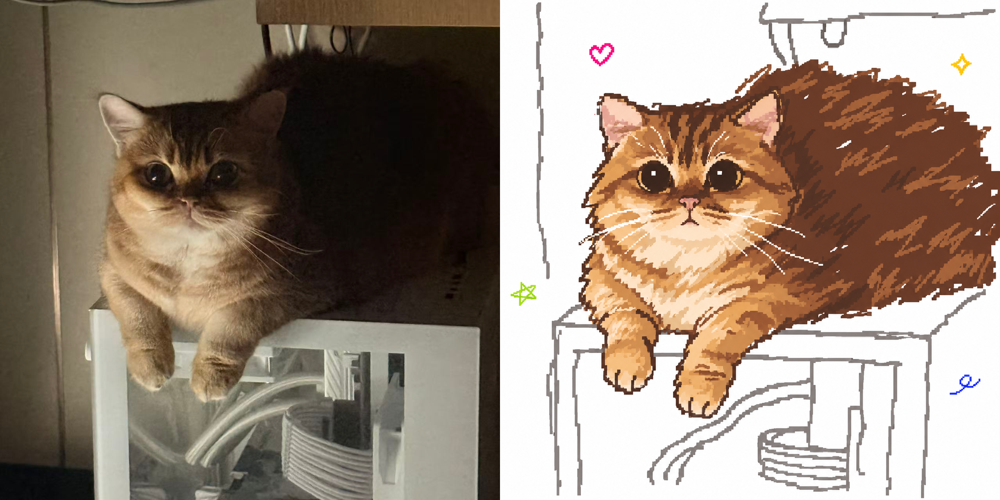
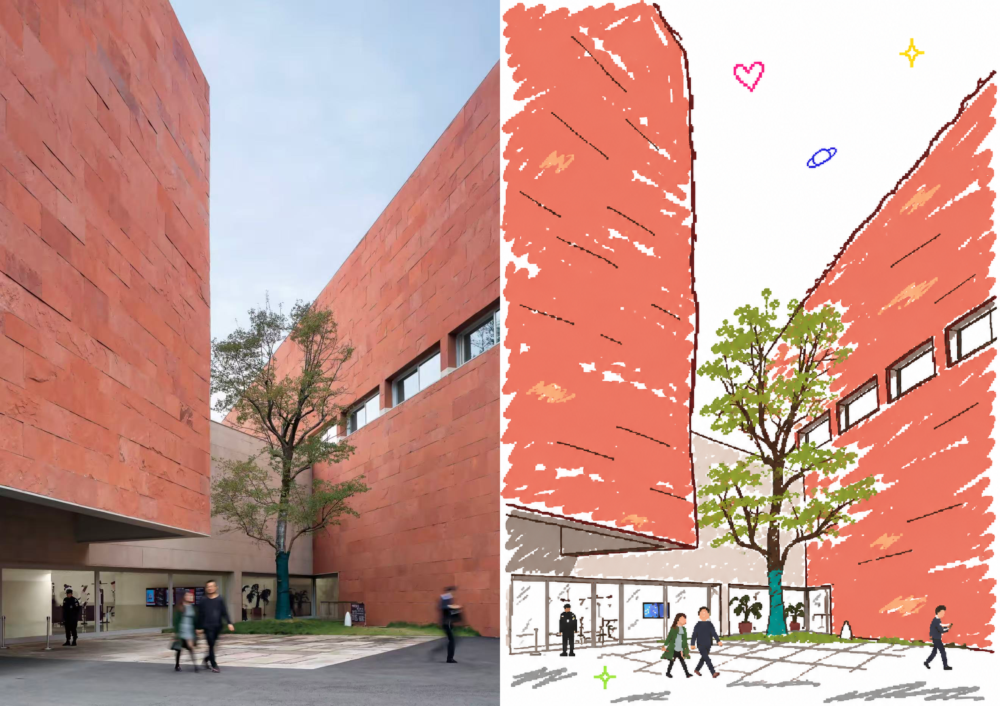

# Y2K Pixel Doodle

[English](README.md) | 简体中文

将照片转成白底手绘像素涂鸦，重现早期电脑画图软件的随性笔触。保留主体可以辨认的姿态与表情，同时用略歪的鼠标线条、松散涂色和微型彩色贴图，画出低清又有手作感的画面。

适用于人物、宠物、物件、建筑和风景。你可以直接要求生成插画，也可以只获取可复用的生图提示词。

## 生成示例

每组对照图都是一张完整图片：左边是原图，右边是对应的生成插画。

### 人物


### 动物



### 建筑



## 风格特点

- **全图共用一支像素笔。** 五官、主体轮廓、背景结构线和装饰使用一致的像素尺度、线条粗细与手绘抖动，避免面部过于精细。
- **保留人物或动物的神态。** 根据视线、眼睛开合、眉毛和嘴角重绘表情，同时保留主体姿态、辨识特征与空间关系。
- **保留手绘失误。** 轮廓略歪，有少量断笔、回描和错位；色块允许露白或稍稍涂出边界，画面不追求精确描摹。
- **根据画面调整背景。** 人物、宠物或物件图只用少量弯曲的结构线交代环境；纯风景则保留重要轮廓和空间层次。
- **点缀微型涂鸦。** 默认在留白处加入少量彩色爱心、星星、圈线等小装饰，大小和位置略有变化。
- **参考原图构图。** 默认沿用画面比例、主体位置和裁切，并尽量保留原图像素尺寸；具体生成和导出能力取决于可用工具。

你的明确要求优先于默认设置。例如，可以要求纯白背景、不加装饰，或指定新的画面比例。

## 使用前需要知道

要直接生成插画，所用 AI 环境需要能够读取图片，并提供图像生成或编辑工具。这个 Skill 本身是一套工作指令，不包含生图模型。

也可以只让助手根据图片编写提示词。能否精确输出指定尺寸，以及最终文件如何导出，取决于当前环境和工具。

## 安装到 Codex

仓库发布后，可以把 GitHub 地址发给 Codex，并输入：

> 请把这个 GitHub 仓库安装为 Skill。

仓库创建完成后，也可以通过命令克隆到个人 Skill 目录：

```bash
mkdir -p "${CODEX_HOME:-$HOME/.codex}/skills"
git clone https://github.com/jiaxinyang1104/y2k-pixel-doodle.git \
  "${CODEX_HOME:-$HOME/.codex}/skills/y2k-pixel-doodle"
```

如果目标目录已存在，`git clone` 会停止，不会直接覆盖。更新前请先检查已有的 Skill。

## 使用方法

开启新的 Codex 对话，上传图片，并通过名称调用 Skill。

**生成插画**

> 用 `$y2k-pixel-doodle` 把这张照片转成白底手绘像素插画，保留姿态和表情。

**加入风格参考图**

> 用 `$y2k-pixel-doodle` 转绘图 1，参考图 2 的像素线条和配色。

**只写提示词**

> 用 `$y2k-pixel-doodle` 根据这张图写一段生图提示词。

**调整默认效果**

> 使用纯白背景，不加小贴图，保持原图的横向比例。

## 文件结构

```text
y2k-pixel-doodle/
├── SKILL.md
├── agents/
│   └── openai.yaml
├── examples/
│   ├── person.png
│   ├── person-original.png
│   ├── person-comparison.png
│   ├── cat.png
│   ├── cat-original.jpg
│   ├── cat-comparison.png
│   ├── courtyard.png
│   ├── courtyard-original.jpg
│   └── courtyard-comparison.png
├── README.md
├── README.zh-CN.md
└── LICENSE
```

- `SKILL.md`：触发说明、视觉规则和工作流程。
- `agents/openai.yaml`：Codex 使用的显示名称、简介和示例调用方式。
- `examples/`：用于 README 展示的原图、生成插画和拼合对照图，并非运行 Skill 的必需输入。

## 许可证

Skill 指令和配套配置采用 [MIT 许可证](LICENSE)。示例图片及其原始素材可能涉及其他权利，发布者在公开或再分发前应确认使用范围。
